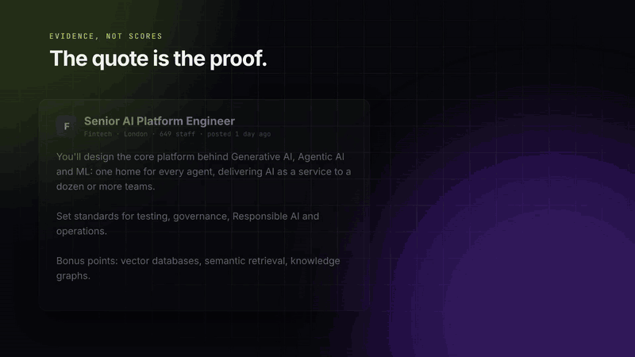

# Signal Stack

[](https://github.com/alfielambert/signal-stack/actions/workflows/tests.yml)
[](LICENSE)

Find companies whose job ads describe the problem you solve, and see the exact sentence that proves it.



Most "intent data" is a score you can't check. Signal Stack gives you the quote instead. When a company writes "Memory, artifacts and event-driven agents come first" into a job ad, they've told you their roadmap, in public.

## Try it in 30 seconds

No API key, no credits:

```bash
git clone https://github.com/alfielambert/signal-stack
cd signal-stack
pip install -r requirements.txt
python signal_stack.py --demo
```

The demo scores 91 real UK job ads for AI platform roles, pulled in November 2026 for a company that sells a knowledge layer for AI agents. Company names are replaced with their industry and each ad is cut down to the text around its signal phrases, so the demo doesn't republish ads or a prospect list. It produces the same 24 companies as the real run. `scripts/make_demo_data.py` shows exactly how it was built.

## What a result looks like

From the demo ([full example report](examples/report.md)):

> **2. Financial Services C (score 9)**
> 649 staff · Financial Services · newest ad 1 day ago
>
> - **agent_platform** ("one home for every agent"): You'll design the core platform behind Generative AI, Agentic AI and ML at Financial Services C: one home for every agent, delivering "AI as a service" to a dozen or more teams...
> - **memory_and_context** ("knowledge graphs"): ...Vector databases and semantic retrieval, knowledge graphs or document understanding systems...
> - **governance** ("governance"): ...Set standards for testing, governance, Responsible AI and operations...

On a real run every rank also links to the ad, so you can check it in ten seconds and open your email with something they actually said.

## How it works

1. **Search.** Runs your job searches on LinkedIn through the [Lix API](https://lix-it.com/?utm_source=github&utm_medium=readme&utm_campaign=signal-stack).
2. **Enrich.** Pulls the full ad and the company's industry and headcount for each job.
3. **Filter.** Drops recruitment agencies, companies under your size floor and ads with no description.
4. **Match.** Checks each ad against your signal themes. Each theme has strong phrases (specific, like "one home for every agent") and weak ones (broad, like "agentic"). Phrases match as whole words, so "RAG" won't fire on "storage".
5. **Rank.** Drops companies that hit fewer than `min_themes` themes, then scores the rest: 3 points for a strong phrase per theme, 1 for a weak one, plus 1 per matching ad and 1 if an ad is under two weeks old. A specific phrase beats a buzzword repeated across many ads.

Scoring is plain rules, not a model. You can explain every rank, and the output doesn't change between runs.

## Run it on your own market

You need a [Lix API](https://lix-it.com/?utm_source=github&utm_medium=readme&utm_campaign=signal-stack) key.

```bash
cp config.example.json config.json
export LIX_API_KEY=your_key
```

Edit `config.json`:

- `searches`: the job searches to run
- `signals`: your themes, each with `strong` and `weak` phrase lists. The strongest match is the one quoted.
- `exclude_industries`: drops recruiters by default
- `min_staff`, `days_back`, `recent_days`: your filters
- `max_requests`: a hard cap on API calls per run

## Run

```bash
python signal_stack.py                 # search, enrich, score
python signal_stack.py --step score    # re-score saved ads after editing signals, no API calls
```

The output goes to `output/`:

- `report.md`: the top 25 companies with evidence
- `companies.csv`: every company, with one evidence column per theme
- `jobs_enriched.jsonl`: the raw enriched ads, so you can re-score for free

Enrichment saves after every ad. If a run stops, run it again and it picks up where it left off.

## Cost

One API call per search page and one per ad enriched. `max_ads_per_company` (default 3) stops one big hirer from eating your budget. Tune your signals with `--step score`, which costs nothing.

## What broke while building it

- **Recruiters were half the results.** A search for "AI platform engineer" in the UK came back roughly half agencies. They're filtered on LinkedIn's industry field, not on name lists.
- **Headcounts lie.** One trading platform came back with `staffCount: 1` next to a range of 1,001 to 5,000. The tool never reports less than the bottom of the range.
- **Keyword search is loose.** An earlier version trusted LinkedIn's job search and matched "Luxury Showroom Sales Consultant" for "AI agents". Every ad's full description is now checked against your phrases before it counts.
- **Page 2 was page 1 again.** In the first real run every search's second page returned the same 25 jobs, wasting a call each. Paging has to go in the LinkedIn URL. The search now also stops as soon as a page brings nothing new.
- **One buzzword isn't a signal.** A recruiter's contract ad ranked because it mentioned "release governance". Companies now need at least two themes (`min_themes`).
- **Everything scored 8.** With one point per theme, 13 of 24 companies tied on the first full run, because "memory" counted the same as "one home for every agent". Phrases are now split into strong and weak.
- **LinkedIn glues bullet points together.** One fintech's ad reads "semantic retrievalKnowledge graphsBuilding", so a plain word-boundary match missed "knowledge graphs". A lowercase letter running into a capital now counts as a boundary.
- **Running out of credits used to leave holes.** A 401, 402 or 403 now stops the run straight away, with progress saved, instead of carrying on with gaps in the data.

## Tests

```bash
pytest -q
```

The tests run on trimmed copies of real API responses in `tests/fixtures/`, so they catch it when the response shape changes.

## Licence

MIT
