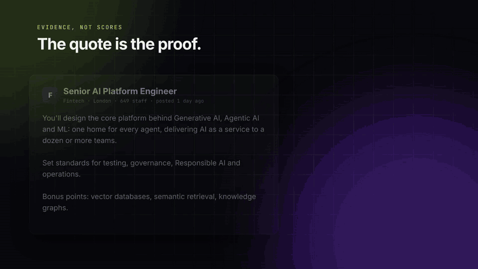

# Signal Stack

[](https://github.com/alfielambert/signal-stack/actions/workflows/tests.yml)
[](LICENSE)

Find companies whose job ads describe the problem you solve, and see the exact sentence that proves it.



Most "intent data" is a score you can't check. Signal Stack gives you the quote instead. When a company writes "Memory, artifacts and event-driven agents come first" into a job ad, they've told you their roadmap, in public.

Run it on your own, or [share it with your team through OpenLore](#share-it-with-your-team-through-openlore) so everyone can see which companies are new, who owns each account and who has already been contacted.

## Try it in 30 seconds

No API key, no credits:

```bash
git clone https://github.com/alfielambert/signal-stack
cd signal-stack
pip install -r requirements.txt
python signal_stack.py --demo
```

The demo scores 91 real UK job ads for AI platform roles, pulled in November 2026 for a company that sells a knowledge layer for AI agents. Company names are replaced with their industry and each ad is cut down to the text around its signal phrases, so the demo doesn't republish ads or a prospect list. It produces the same 24 companies as the real run. `scripts/make_demo_data.py` shows exactly how it was built.

## What a result looks like

From the demo ([full example report](examples/report.md)):

> **2. Financial Services C (score 9)**
> 649 staff · Financial Services · newest ad 1 day ago
>
> - **agent_platform** ("one home for every agent"): You'll design the core platform behind Generative AI, Agentic AI and ML at Financial Services C: one home for every agent, delivering "AI as a service" to a dozen or more teams...
> - **memory_and_context** ("knowledge graphs"): ...Vector databases and semantic retrieval, knowledge graphs or document understanding systems...
> - **governance** ("governance"): ...Set standards for testing, governance, Responsible AI and operations...

On a real run every rank also links to the ad, so you can check it in ten seconds and open your email with something they actually said.

## How it works

1. **Search.** Runs your job searches on LinkedIn through the [Lix API](https://lix-it.com/?utm_source=github&utm_medium=readme&utm_campaign=signal-stack).
2. **Enrich.** Pulls the full ad and the company's industry and headcount for each job.
3. **Filter.** Drops recruitment agencies, companies under your size floor and ads with no description.
4. **Match.** Checks each ad against your signal themes. Each theme has strong phrases (specific, like "one home for every agent") and weak ones (broad, like "agentic"). Phrases match as whole words, so "RAG" won't fire on "storage".
5. **Rank.** Drops companies that hit fewer than `min_themes` themes, then scores the rest: 3 points for a strong phrase per theme, 1 for a weak one, plus 1 per matching ad and 1 if an ad is under two weeks old. A specific phrase beats a buzzword repeated across many ads.

Scoring is plain rules, not a model. You can explain every rank, and the output doesn't change between runs.

## Run it on your own market

You need a [Lix API](https://lix-it.com/?utm_source=github&utm_medium=readme&utm_campaign=signal-stack) key.

```bash
cp config.example.json config.json
export LIX_API_KEY=your_key
```

Edit `config.json`:

- `searches`: the job searches to run
- `signals`: your themes, each with `strong` and `weak` phrase lists. The strongest match is the one quoted.
- `exclude_industries`: drops recruiters by default
- `min_staff`, `days_back`, `recent_days`: your filters
- `max_requests`: a hard cap on API calls per run
- `openlore.dir`: an OpenLore knowledge folder your team shares (see below)

## Run

```bash
python signal_stack.py                 # search, enrich, score
python signal_stack.py --step score    # re-score saved ads after editing signals, no API calls
```

The output goes to `output/` (the demo writes to `output/demo/` instead):

- `report.md`: the top 25 companies with evidence
- `companies.csv`: every company, with one evidence column per theme
- `jobs_enriched.jsonl`: the raw enriched ads, so you can re-score for free

Enrichment saves after every ad. If a run stops, run it again and it picks up where it left off.

## Share it with your team through OpenLore

On its own, each run starts from nothing and lives on one laptop. It can't tell you which companies are new this week, whose score went up, or who on your team is already talking to them.

Point it at an [OpenLore](https://github.com/aakarim/OpenLore) knowledge folder and every run becomes shared team memory:

```bash
python signal_stack.py --openlore ~/knowledge/docs/gtm/signal-stack
python signal_stack.py --demo --openlore /tmp/signal-stack-kb   # try it with the demo
```

OpenLore serves the folder to everyone on the team and to their agents: Claude Code, Codex, Cursor or a scheduled job. They all work from the same pages.

### What a week looks like

- **Monday:** the run finds 24 companies and writes a page for each, with the quotes, every ad seen and the score.
- **Monday afternoon:** Sam claims three accounts by setting `owner: sam`. You claim two. The run page lists the rest as unclaimed, so nobody emails the same company twice.
- **Tuesday:** you email your two and set `outreach: contacted`. Claude Code can draft those emails from the same evidence pages.
- **Wednesday:** one replies. You set `outreach: replied` and add a dated line under `## Notes`.
- **Next Monday:** the run skips everyone already in play, flags the new companies, and shows each owner what moved on their accounts.

Meanwhile any agent on the team can answer "which unclaimed companies mention governance?" from the folder, with `grep` or `lore meta`, without anyone exporting a spreadsheet.

### What belongs to the team

Signal Stack rewrites each company page on every run, but never touches three things:

| Field | What it's for |
|---|---|
| `owner:` | Who is working the account. Each run page groups companies by owner and lists the unclaimed ones. |
| `outreach:` | new, contacted, replied, meeting, customer or not-a-fit. At contacted or beyond, a company leaves the ranking and moves to "Already in play". Change the list with `openlore.in_play`. |
| `## Notes` | Call notes, who to talk to, what they said. Kept word for word. |

People and agents can edit these while a run is going. Signal Stack re-reads each page just before writing it, builds on what's there at that moment, and only saves if nothing changed in between. If someone saves at the same instant, it reads again and retries. The log tells you whose edits it kept.

### What's in the folder

```
index.md               every company, best score first, with owner and outreach
log.md                 one line per run, newest first
guide.md               how agents should read and update the folder
companies/<name>.md    evidence, every ad seen, score history, team fields
runs/<date>.md         new companies, rising scores, already in play, by owner, unclaimed
```

The folder is an [Open Knowledge Format](https://github.com/GoogleCloudPlatform/knowledge-catalog/blob/main/okf/SPEC.md) bundle and passes OpenLore's own validator. Signal Stack writes to a local folder, so use the folder your OpenLore server serves, or mount a remote server's folder over SSHFS. Writing straight to the server over SSH, with Signal Stack as its own identity and every change in `lore history`, is next.

## Cost

One API call per search page and one per ad enriched. `max_ads_per_company` (default 3) stops one big hirer from eating your budget. Tune your signals with `--step score`, which costs nothing.

## What broke while building it

- **Recruiters were half the results.** A search for "AI platform engineer" in the UK came back roughly half agencies. They're filtered on LinkedIn's industry field, not on name lists.
- **Headcounts lie.** One trading platform came back with `staffCount: 1` next to a range of 1,001 to 5,000. The tool never reports less than the bottom of the range.
- **Keyword search is loose.** An earlier version trusted LinkedIn's job search and matched "Luxury Showroom Sales Consultant" for "AI agents". Every ad's full description is now checked against your phrases before it counts.
- **Page 2 was page 1 again.** In the first real run every search's second page returned the same 25 jobs, wasting a call each. Paging has to go in the LinkedIn URL. The search now also stops as soon as a page brings nothing new.
- **One buzzword isn't a signal.** A recruiter's contract ad ranked because it mentioned "release governance". Companies now need at least two themes (`min_themes`).
- **Everything scored 8.** With one point per theme, 13 of 24 companies tied on the first full run, because "memory" counted the same as "one home for every agent". Phrases are now split into strong and weak.
- **LinkedIn glues bullet points together.** One fintech's ad reads "semantic retrievalKnowledge graphsBuilding", so a plain word-boundary match missed "knowledge graphs". A lowercase letter running into a capital now counts as a boundary.
- **Running out of credits used to leave holes.** A 401, 402 or 403 now stops the run straight away, with progress saved, instead of carrying on with gaps in the data.

## Tests

```bash
pytest -q
```

The tests run on trimmed copies of real API responses in `tests/fixtures/`, so they catch it when the response shape changes.

## Licence

MIT
